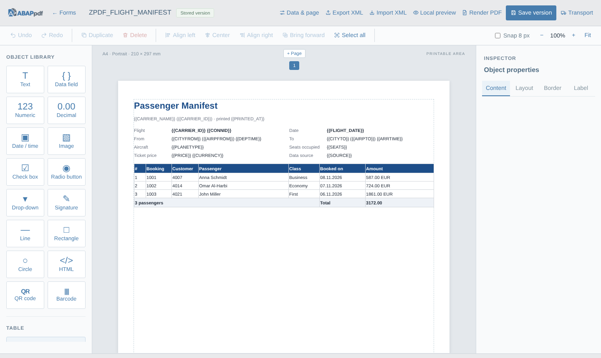
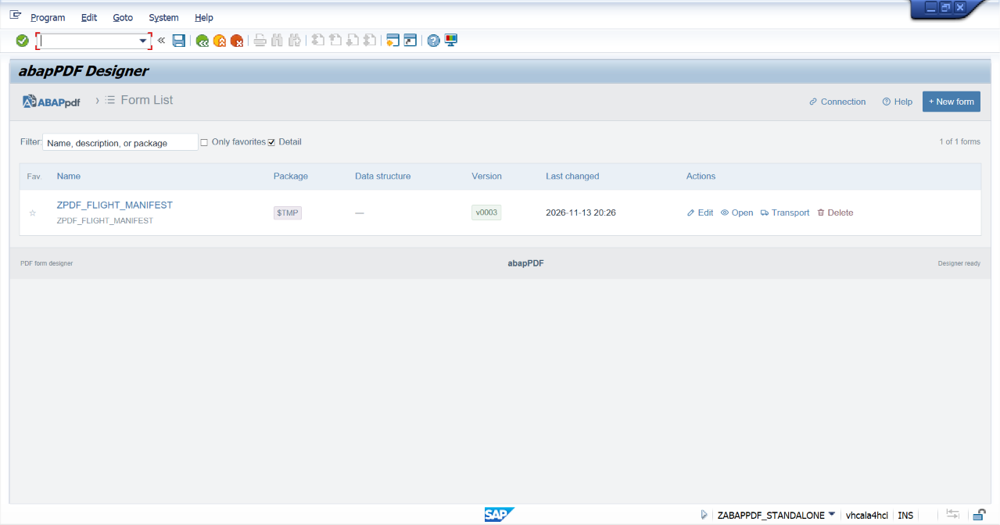
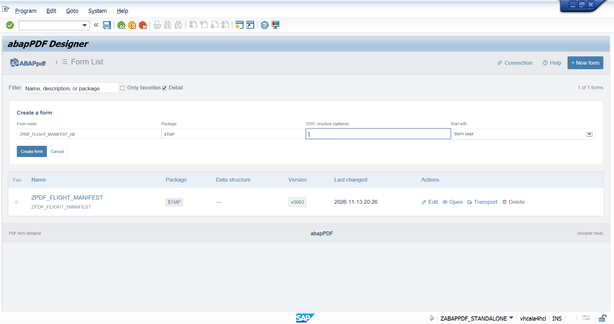
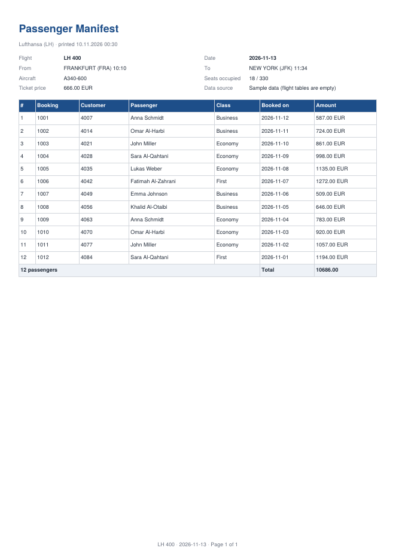
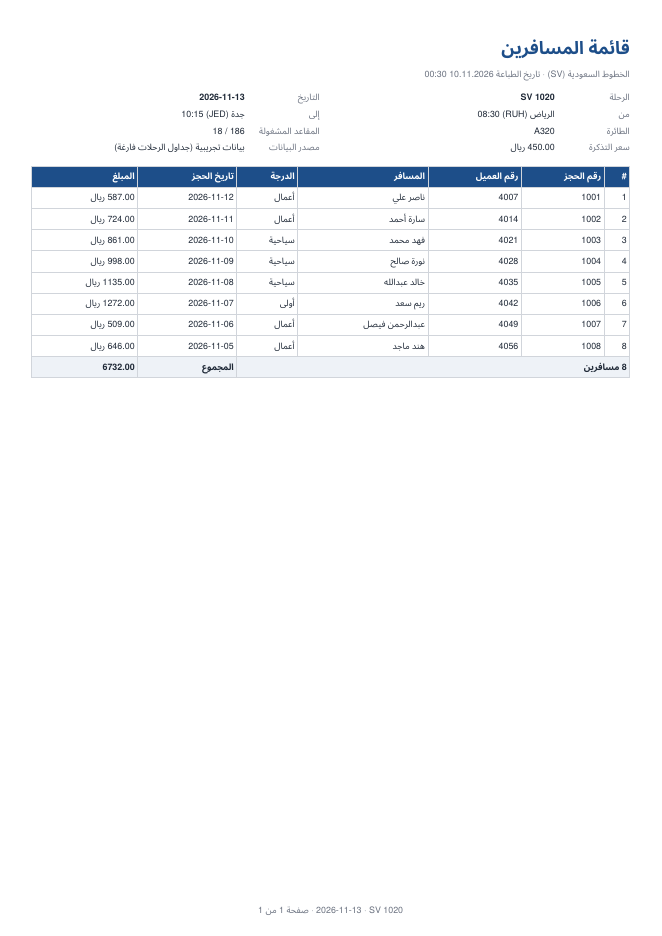

# abapPDF

PDF form designer and native PDF renderer for SAP, written in pure ABAP.

Design a form in a visual designer inside SAP GUI, bind it to ABAP data with simple `{{FIELD}}` tags, and get a PDF from one method call. No Adobe Document Services, no Smart Forms, no external service. Arabic text is shaped and printed right to left.



## Features

- **Visual designer** in SAP GUI: text, data fields, tables with repeating headers and totals, images, lines, shapes, check boxes, QR codes and Code 128 barcodes. Undo/redo, multi-select, alignment, local preview.
- **Native PDF engine** in ABAP: page sizes A3, A4, A5, Letter and Legal, portrait or landscape, page headers and footers with page numbers, tables that continue over several pages.
- **Arabic support**: letter shaping (joined forms, lam-alef), right-to-left pages and tables, mixed Arabic and Latin text, and an embedded subset of Noto Sans Arabic. An Arabic demo form is included.
- **Template binding**: fields, loops, conditions, totals and number/date formats (see below).
- **Transportable forms**: forms are stored in table `ZPDF_FORMDB` and can be added to a transport request from the designer.
- **Safe output**: `{{FIELD}}` is HTML-escaped; `{{{FIELD}}}` keeps only an allow-list of formatting tags.
- **Optional Gotenberg** engine (Chromium) for full HTML/CSS, reached only through an SM59 destination.

## Screenshots

**Home screen (form list):** all forms of the client, with edit, open, transport and delete.



**New form:** create a form with a name, a package and an optional DDIC structure that fills the field list.



**Output:** the demo forms in English and Arabic, rendered by the native engine.

<p>
  
  
</p>

## Requirements

- SAP NetWeaver ABAP 7.40 SP08 or higher, or SAP S/4HANA. Developed and tested on the SAP ABAP Cloud Developer Trial 2025 (A4H), using classic ABAP.
- SAP GUI for Windows for the designer. The Edge (WebView2) browser control is recommended.
- Classic ABAP (on-premise). An ABAP Cloud edition is planned in a separate repository.

## Installation

### With abapGit (recommended)

1. Create a package, for example `ZABAPPDF` (or `$ABAPPDF` for a local test).
2. In abapGit, create an online repository with this URL and the package, then **Pull**. Or download this repository as ZIP and use an offline repository with **Import zip**.
3. Activate all objects.

### Quick install (one program)

`ZABAPPDF_STANDALONE` contains the whole tool as local classes. Create the program in SE38, paste `src/zabappdf_standalone.prog.abap` and activate.
Without table `ZPDF_FORMDB` the forms are stored in `INDX(ZP)` (not transportable). To get transportable forms, create the table as described in the program header.

## Getting started

1. Run **`ZABAPPDF_STANDALONE`**. On the first start in a client without forms, two demo forms are installed:
   `ZPDF_FLIGHT_MANIFEST` (English) and `ZPDF_FLIGHT_MANIFEST_AR` (Arabic, right to left).
2. Open a form with **Edit**, change it, and use **Render PDF** to see the result.
3. Run **`ZABAPPDF_DEMO_FLIGHTS`** and choose the language (English or Arabic) to print the passenger list with data
   from the flight model (`SFLIGHT`, `SBOOK`), download it and optionally send it by e-mail.
   If the flight tables are empty, run `SAPBC_DATA_GENERATOR` first; until then the demo prints sample data.

The demo forms are also in the [forms](forms) folder; use **Import XML** in the designer to load them again.

## Use it in your code

Render a form from the designer:

```abap
TYPES: BEGIN OF ty_item,
         name   TYPE string,
         amount TYPE string,
       END OF ty_item,
       BEGIN OF ty_doc,
         customer TYPE string,
         items    TYPE STANDARD TABLE OF ty_item WITH EMPTY KEY,
       END OF ty_doc.

DATA(ls_doc) = VALUE ty_doc(
  customer = 'ACME'
  items    = VALUE #( ( name = 'Item 1' amount = '10.00' )
                      ( name = 'Item 2' amount = '25.50' ) ) ).

TRY.
    DATA(lv_pdf) = zcl_pdf_api=>render_pdf(
      iv_form_id = 'ZMY_FORM'
      is_data    = ls_doc ).
    zcl_pdf_api=>download_pdf(
      iv_pdf_xstring = lv_pdf
      iv_filename    = 'invoice.pdf' ).
  CATCH zcx_pdf INTO DATA(lx_pdf).
    MESSAGE lx_pdf->get_text( ) TYPE 'I'.
ENDTRY.
```

Or render an HTML template from your own code, without a stored form:

```abap
DATA(lv_pdf) = zcl_pdf_api=>render_html(
  iv_html   = `<h1>Hello {{CUSTOMER}}</h1>`
  iv_footer = `<div style="text-align:center">Page <span class="pageNumber"></span> of <span class="totalPages"></span></div>`
  is_page   = VALUE #( page_size = 'A4' orientation = 'P'
                       margin_top = 15 margin_right = 12 margin_bottom = 18 margin_left = 12 )
  is_data   = ls_doc ).
```

Field names are the component names of your structure, case-insensitive.

## Template syntax

| Syntax | Meaning |
|---|---|
| `{{FIELD}}` | Value of a field, HTML-escaped |
| `{{HEADER.FIELD}}` | Field of a nested structure |
| `{{{FIELD}}}` | Formatted HTML from a field (allow-listed tags only) |
| `{{#each ITEMS}} ... {{else}} ... {{/each}}` | Repeat for every row of a table; `{{else}}` when it is empty |
| `{{ROW}}` | Row number inside `{{#each}}` |
| `{{#if FIELD}} ... {{else}} ... {{/if}}` | Condition (not initial, or a table with rows) |
| `{{#if ROW_EVEN}}`, `{{#if ROW_ODD}}` | Alternating rows |
| `{{^FIELD}} ... {{/FIELD}}` | Inverted condition |
| `{{../FIELD}}` | Field of the outer level inside a loop |
| `{{sum ITEMS.AMOUNT}}`, `{{count ITEMS}}`, `{{avg ...}}`, `{{min ...}}`, `{{max ...}}` | Totals at print time |
| `{{! comment }}` | Comment, not printed |

Formats are set in the designer, or with `data-fmt` in HTML:

```html
<span data-fmt="#,##0.00">{{AMOUNT}}</span>     1,234.50
<span data-fmt="#.##0,00">{{AMOUNT}}</span>     1.234,50
<span data-fmt="AR#,##0.00">{{AMOUNT}}</span>   Arabic-Indic digits
<span data-fmt="DD.MM.YYYY">{{DATE}}</span>     also MM/DD/YYYY, YYYY-MM-DD, YYYY/MM/DD, AR
```

## Authorization

The tool checks authorization object `S_PROGRAM` with activity `SUBMIT` and these groups:

| Group | Allows |
|---|---|
| `ZPDFVIEW` | Open the designer and print forms (also through `ZCL_PDF_API`) |
| `ZPDFEDIT` | Create, change, save and transport forms |
| `ZPDFADMN` | Delete forms (together with `ZPDFEDIT`) |

## Objects

| Object | Purpose |
|---|---|
| `ZABAPPDF_STANDALONE` | Designer (also usable as a one-program install) |
| `ZABAPPDF_DEMO_FLIGHTS` | Demo: passenger list in English or Arabic, download and e-mail |
| `ZCL_PDF_API` | Entry point: `render_pdf`, `render_html`, `download_pdf` |
| `ZCL_PDF_DATA_BINDER` | Fills the template tags from ABAP data |
| `ZCL_PDF_RENDERER` | Chooses the engine (native or Gotenberg) |
| `ZCL_PDF_NATIVE` | Native PDF engine |
| `ZCL_PDF_ARABIC` | Arabic shaping and embedded font |
| `ZCL_PDF_CODES` | QR code and Code 128 |
| `ZCL_PDF_FORM_MANAGER` | Form store (table `ZPDF_FORMDB`) and transport |
| `ZCL_PDF_CONVERT` | String, xstring and Base64 helpers |
| `ZCX_PDF` | Exception class |
| `ZPDF_FORMDB` | Form storage (client-dependent, transportable) |

## Gotenberg (optional)

The native engine is the default. To use [Gotenberg](https://gotenberg.dev) instead, create the SM59 destination `ZPDF_GOTENBERG` (type G) that points to your Gotenberg server and select the Gotenberg engine on the selection screen of `ZABAPPDF_STANDALONE`. Run Gotenberg with JavaScript disabled and a deny list for internal hosts, because templates can reference external URLs.

## License

[MIT](LICENSE).

## Credits

Arabic text is printed with a subset of [Noto Sans Arabic](https://github.com/notofonts/arabic) by the Noto Project Authors, licensed under the [SIL Open Font License 1.1](OFL.txt).
